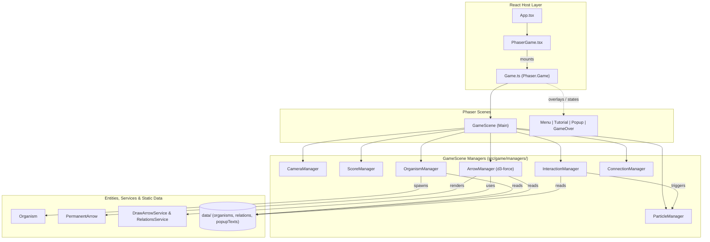
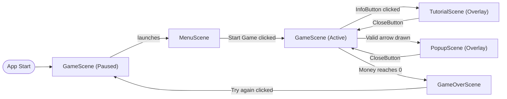
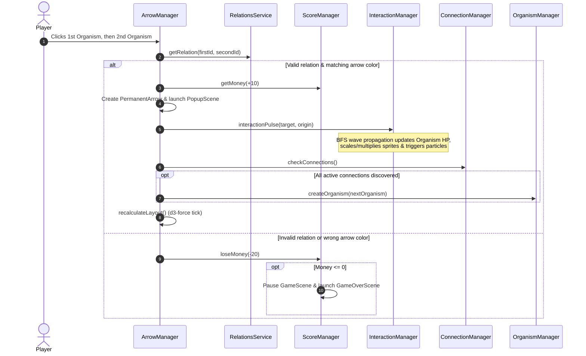

# Architecture Overview

## Tech Stack

- **UI Host**: React 19 + Vite (`src/main.tsx`, `src/App.tsx`, `src/components/PhaserGame.tsx`)
- **Game Engine**: Phaser 4 (2D WebGL/Canvas rendering, scenes, cameras, particles, tweens)
- **Force Layout**: `d3-force` (dynamic force-directed node positioning for organisms and arrows)
- **Testing & Quality**: Vitest (unit/component tests + V8 coverage), Playwright (E2E browser tests), ESLint
- **Infrastructure & CI/CD**: Docker (`Dockerfile`, `compose.yml`), GitHub Actions (`.github/workflows/`), OpenShift Kubernetes (`manifests/staging`, `manifests/prod`)

---

## Project Structure

```text
├── src/
│   ├── main.tsx & App.tsx       # React entry point
│   ├── components/
│   │   └── PhaserGame.tsx       # React wrapper mounting/destroying the Phaser instance
│   └── game/
│       ├── Game.ts              # Phaser.Game configuration and scene registration
│       ├── scenes/              # Phaser scenes (Game, Menu, Tutorial, Popup, GameOver)
│       ├── managers/            # Core game logic, state, layout, and subsystems
│       ├── entities/            # Interactive Phaser GameObjects (Organism, Arrows, UI Buttons)
│       ├── services/            # Stateless helpers (arrow geometry, relation lookups)
│       ├── data/                # Static domain data (organisms, relations, popup texts)
│       └── types/               # Shared TypeScript types (Connection)
├── public/assets/               # Organism sprites, UI button icons, and particle textures
├── tests/                       # Vitest unit/component tests & Playwright E2E tests
└── manifests/                   # OpenShift deployment configs (staging & prod)
```

---

## High-Level System Architecture

React acts as a thin host container (`PhaserGame.tsx`) that initializes the Phaser game (`Game.ts`). Inside Phaser, `GameScene` acts as the central controller, coordinating specialized managers, entities, services, and static data.



---

## Scene Lifecycle & Navigation

`GameScene` runs the main game world while other Phaser scenes are launched as parallel modal overlays or state transitions.



---

## Core Modules Breakdown

### 1. Managers (`src/game/managers/`)

| Manager                  | Responsibility                                                                                                                                                                                                                     |
| :----------------------- | :--------------------------------------------------------------------------------------------------------------------------------------------------------------------------------------------------------------------------------- |
| **`ArrowManager`**       | Handles player arrow selection/drawing, validates connections via `RelationsService`, triggers new organism spawns when all current relations are found, and runs the **`d3-force` simulation** to dynamically position organisms. |
| **`OrganismManager`**    | Spawns `Organism` entities on the canvas and computes all expected valid connections (`rightConnections`) among currently active organisms.                                                                                        |
| **`InteractionManager`** | Runs a Breadth-First Search (BFS) `interactionPulse` across connected organisms whenever a new arrow is formed, propagating health (`hp`) changes wave-by-wave.                                                                    |
| **`ConnectionManager`**  | Compares player-created connections against `rightConnections` to check level progression or find missing connections for hints.                                                                                                   |
| **`ScoreManager`**       | Tracks player money/score (starts at `1000`, `+10` for valid connections, `-20` for wrong guesses, `-100` for hints, triggers `GameOverScene` at `0`).                                                                             |
| **`CameraManager`**      | Manages a dual-camera setup: the **main camera** (supports pan and zoom for the game world) and a fixed **UI camera** (renders HUD buttons and score).                                                                             |
| **`ParticleManager`**    | Emits positive (green) or negative (red) particle bursts when an organism's health changes.                                                                                                                                        |

### 2. Entities (`src/game/entities/`)

- **`Organism`**: Sprite representing a species in the ecosystem. Tracks `hp` and reacts visually to health changes based on its `growth_types` (`"grow"` scales the sprite size; `"multiply"` spawns/destroys surrounding duplicate sprites). Also supports hover/hint glow filters.
- **`PermanentArrow`**: Renders established directional connections between organisms (with lateral offset when bidirectional) and animates traveling pulse circles during health propagation.
- **UI Buttons**:
  - `ArrowButtons`: Green (`+1`) and Red (`-1`) toggle buttons to select the interaction type to draw.
  - `InfoButton`: Opens `TutorialScene`.
  - `HintButton`: Deducts 100 money via `ScoreManager` and highlights two organisms that are missing a valid connection.
  - `CloseButton`: Closes overlay scenes (`TutorialScene`, `PopupScene`).

### 3. Services, Data & Types

- **`DrawArrowService`**: Calculates unit vectors, perpendicular lane shifts, and triangle arrowhead geometry for Phaser `Graphics`.
- **`RelationsService`**: Looks up the relation `{ value, mult }` between a source and target organism from static data.
- **`data/`**:
  - `organisms.ts`: Metadata for the organisms (IDs, names, sprite keys, default scales, spawn offsets, and `growth_types`).
  - `relations.ts`: Directed graph edges defining positive (`1`) and negative (`-1`) ecological relations.
  - `popupTexts.ts`: Educational titles, relation types (e.g., _Symbiotic_, _Competitive_, _Harmful_), and descriptions shown in `PopupScene`.
- **`types/Connection.ts`**: Shared `{ from: string, to: string }` type representing directed edges between organisms.

---

## Core Gameplay Flow (Connecting Two Organisms)

When a player selects an arrow color (green = positive `+1`, red = negative `-1`) and clicks two organisms, the following flow occurs:


